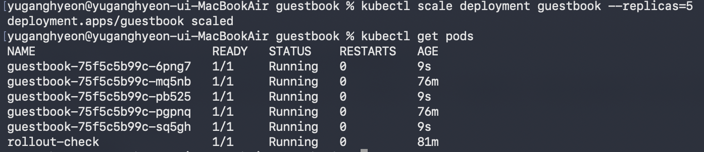

# Week10 Kubernetes 배포와 서비스

## 1. YAML 파일을 이용한 배포
명령어를 하나씩 입력하면 이전 명령어를 기억하거나 다시 찾기 어려울 수 있다. 
YAML 파일에 원하는 설정을 기록하고 `kubectl apply`로 적용하면 관리와 수정이 편리하다는 것을 알았다.

## 2. Deployment와 자가 치유
guestbook 앱을 Pod로 실행하고, Pod 하나를 삭제했을 때 
새로운 Pod가 자동으로 생성되어 설정한 개수를 유지하는 것을 확인했다.

## 3. Service
Service를 생성하여 여러 Pod에 요청을 분산했다. 
각 Pod가 서로 다른 메모리를 사용하기 때문에 새로고침할 때 연결되는 Pod에 따라 방명록 글이 보였다 사라지는 현상을 확인했다.

## 4. 스케일링
`replicas`를 5로 늘려 guestbook Pod가 5개 실행되는 것을 확인했다. 
이를 통해 필요에 따라 앱의 실행 개수를 조절할 수 있다는 것을 알았다.

## 5. 롤링 업데이트
새로운 이미지를 GHCR에 올린 뒤 Deployment의 이미지 버전을 변경했다. 
기존 Pod를 한 번에 종료하지 않고 새로운 Pod로 순차적으로 교체하는 방식을 확인했다.

